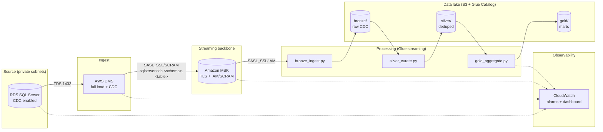

# Terraform-Managed Streaming Data Platform: SQL Server → MSK → Delta Lake

An end-to-end, **100% Terraform-managed** AWS data platform that streams change-data-capture (CDC) events from Microsoft SQL Server into Amazon MSK, then processes them with AWS Glue streaming jobs into **Delta Lake bronze / silver / gold** tables on S3.

Built as a DevOps portfolio project: every resource — VPC, MSK, RDS, DMS, S3, Glue, IAM, monitoring — is declared in Terraform with remote state, environment parity, CI checks, and production-grade defaults (encryption everywhere, least-privilege IAM, autoscaling, alerting).

## Architecture



## Repository layout

```
├── main.tf / variables.tf / outputs.tf / locals.tf   # root module wiring
├── backend.tf / backend.hcl.example                  # S3 + DynamoDB remote state
├── modules/
│   ├── networking/     # VPC, subnets, NAT, SGs, VPC endpoints, Glue connection
│   ├── msk/            # MSK cluster (TLS + IAM/SCRAM), KMS, storage autoscaling
│   ├── rds-mssql/      # SQL Server source, Secrets Manager creds, CDC-ready
│   ├── dms/            # replication instance, endpoints, CDC task + table mappings
│   ├── s3-data-lake/   # lake + scripts buckets, KMS, lifecycle, access logging
│   ├── glue-streaming/ # 3 streaming jobs + Data Catalog database/tables
│   ├── iam/            # least-privilege roles (Glue, DMS service roles)
│   └── monitoring/     # alarms, SNS topic, CloudWatch dashboard
├── glue-jobs/          # PySpark Structured Streaming (bronze/silver/gold)
├── scripts/            # one-time SQL: enable_cdc.sql
├── environments/       # dev.tfvars / prod.tfvars
├── docs/               # architecture, runbook, interview guide, cost estimate
└── .github/workflows/  # terraform-ci.yml (fmt, validate, tflint, plan)
```

| Module | Responsibility |
|---|---|
| `networking` | VPC (3 AZs), public/private subnets, NAT, S3 + Glue VPC endpoints, workload security groups, Glue network connection |
| `msk` | MSK cluster, broker config, dedicated KMS key, SCRAM secret for DMS, storage autoscaling, broker logging |
| `rds-mssql` | SQL Server instance, parameter group, random master password in Secrets Manager |
| `dms` | Replication instance/subnet group, SQL Server + Kafka endpoints, full-load-and-CDC task with JSON table mappings |
| `s3-data-lake` | Data-lake + scripts buckets, KMS encryption, versioning, lifecycle policies, access logging, script upload |
| `glue-streaming` | Bronze/silver/gold `glueetl` streaming jobs (bookmarks, autoscaling, logging, checkpoints), catalog database + Delta tables |
| `iam` | Glue job role (managed + least-privilege data-plane policy), the two AWS-required DMS service roles |
| `monitoring` | MSK log group, SNS alarm topic, 7 CloudWatch alarms, pipeline dashboard |

## Prerequisites

- Terraform >= 1.5, AWS CLI v2, an AWS account with permissions to create VPC/MSK/RDS/DMS/Glue/IAM resources.
- Remote-state bootstrap (one-time per account/region): an S3 bucket + DynamoDB table — see `docs/runbook.md`.
- `backend.<env>.hcl` copied from `backend.hcl.example` and filled in.

## Quickstart

```bash
# 1. Configure
cp backend.hcl.example backend.dev.hcl        # fill in state bucket/table
cp terraform.tfvars.example terraform.tfvars  # set environment + owner

# 2. Standard workflow (or use the Makefile: make init/plan/apply ENV=dev)
terraform init -backend-config=backend.dev.hcl
terraform fmt -check -recursive
terraform validate
terraform plan -var-file=environments/dev.tfvars -out=tfplan
terraform apply tfplan

# 3. Post-apply (one-time)
#   a. Enable CDC on the source DB:  scripts/enable_cdc.sql  (docs/runbook.md)
#   b. Subscribe to the SNS alarm topic output by `terraform output`
#   c. Start the Glue jobs (they are created stopped):
#        aws glue start-job-run --job-name <prefix>-bronze   # then silver, gold
```

Apply order note: the root module's `depends_on` chain applies networking → iam/s3/monitoring → msk/rds → dms → glue automatically; you don't need to target modules manually.

## Security notes

- No credentials in code: RDS master password and MSK SCRAM secrets are generated by Terraform and stored in Secrets Manager.
- Encryption in transit everywhere (TLS/SASL_SSL); encryption at rest with dedicated KMS keys (MSK, S3), all with rotation enabled.
- MSK: IAM auth for Glue consumers, SCRAM for the DMS producer (DMS Kafka targets don't support MSK IAM), no plaintext listeners.
- S3: public access blocked, versioning on, access logging on.
- IAM: least-privilege data-plane policy for Glue (bucket-, key-, cluster-scoped); DMS source credentials via Secrets Manager, never in config.

## Cost estimate

See `docs/cost-estimate.md`. Roughly: **dev ≈ $450–650/month** (t3.small brokers, single-AZ RDS, small workers), **prod ≈ $1,800–2,600/month** (m5.large brokers, Multi-AZ RDS, G.2X × 8 workers). The dev environment exists precisely so you can demo and tear down cheaply (`make destroy ENV=dev`).

## Docs

- `docs/architecture.md` — design decisions (why DMS over Debezium, why Delta Lake, why this auth mix).
- `docs/runbook.md` — deploy, verify, operate, troubleshoot, destroy.
- `docs/interview-guide.md` — likely DevOps interview questions mapped to this project, with strong answers.
- `docs/cost-estimate.md` — line-item cost model per environment.
